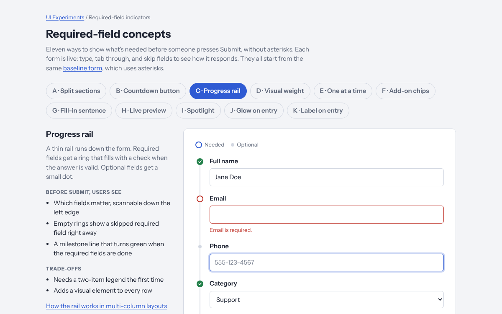

# Required-field indicators

**View it live:** https://ianlee74.github.io/ui-experiments/experiments/required-field-indicators/

## The problem

Forms usually mark required fields with an asterisk (`*`). Designers often don't like how it looks. But without some signal, people have two complaints:

- They don't find out they skipped a required field until they press Submit.
- They fill in fields they didn't need to, because nothing told them those fields were optional.

The goal is to answer both complaints, before Submit, without the asterisk and without hurting the look of the form.

## The pages

| Page | What it is |
| --- | --- |
| [`baseline.html`](baseline.html) | The starting point: a plain form with asterisks and standard validation. |
| [`index.html`](index.html) | Eleven concepts, A to K, one per tab. Each one is a working form. |
| [`rail-columns.html`](rail-columns.html) | Three ways concept C (Progress rail) can work when fields sit side by side in a grid. |

Every concept uses the same eight fields and the same validation rules, so they can be compared fairly:

| Field | Required? | Rule |
| --- | --- | --- |
| Full name | Required | At least 2 characters |
| Email | Required | Looks like an email address |
| Phone | Optional | Phone-number format, if filled in |
| Category | Required | Pick an option |
| Quantity | Optional | Whole number from 1 to 100, if filled in |
| Website | Optional | An http(s) URL, if filled in |
| Notes | Optional | Up to 500 characters |
| I agree to the terms | Required | Must be checked |

Error messages appear once someone leaves a field, and update live after that. Submitting with errors shows them all and moves focus to the first one. Nothing is sent anywhere.

## The concepts

| | Concept | How it signals required vs. optional | Main trade-off |
| --- | --- | --- | --- |
| A | Split sections | Required fields sit under "The essentials" with a live "2 of 4 done" count; optional fields are tucked behind "Add more details". | Field order follows required/optional rather than topic. |
| B | Countdown button | Submit reads "3 required fields left" above a segmented meter; a "Still needed" line names what's missing and jumps to it. Optional fields say "Optional" as placeholder text. | The signal is at the bottom, which can be off screen on long forms. |
| C | Progress rail | A line down the left edge: rings for required fields that fill with a check, small dots for optional ones. | Needs a short legend, and adds a mark to every row. |
| D | Visual weight | Optional fields fade back (muted labels, sunken fill); empty required fields carry a colored stripe on their left edge. | Relies on contrast alone, which is hard for people with low vision. |
| E | One at a time | One question per screen; only optional questions have a Skip button. | Slower, and people can't see the whole form at once. |
| F | Add-on chips | Only required fields are shown; each optional field is a "+ Phone" style chip that adds it. | Optional fields are easy to miss if you want people to fill them in. |
| G | Fill-in sentence | The form reads as a note; required blanks are in the main sentence, optional ones in a "P.S.". | Only suits short, conversational forms, and is hard to translate. |
| H | Live preview | A card shows what will be sent; missing required items are dashed "Needed" slots. | Takes horizontal space; on phones the card scrolls away. |
| I | Spotlight | The next required field is highlighted with a "Next" tag, which changes to "Skipped" if someone moves past it. | Shows one field at a time, not the full list. |
| J | Glow on entry | Moving into any field makes every unfinished required field glow briefly, top to bottom. | Fields scrolled out of view glow where nobody sees them. |
| K | Label on entry | "(optional)" appears after an optional field's label only while that field has focus. | People only learn a field is optional once they're in it. |

Concepts can be combined. For example, A's grouping with B's "Still needed" line, or J (which flags what's still needed) with K (which confirms what can be skipped).

## Progress rail in multi-column forms

The rail in concept C has one mark per field, which only works when every field has its own row. In a grid, fields share rows, so each mark on the rail has to stand for something else. [`rail-columns.html`](rail-columns.html) tries three answers, with a Desktop/Phone switch to show how each one collapses:

1. **Row glyphs.** Each rail mark is a small pill with one mark per field in that row, left to right. On a phone each pill splits back into one ring per field, which is concept C unchanged. The best fit for ordinary forms with paired fields.
2. **Rail per column.** Each column gets its own rail and count. Only fits when the columns are real groups that people finish one at a time.
3. **Section rail.** The rail tracks sections, each drawn as a ring that fills as its required fields are done, with small marks on the field labels. Scales to long forms and any grid.

## Accessibility notes

- Required controls carry `aria-required="true"` in every concept, so assistive technology gets the same information whatever the visual treatment.
- Error messages are linked to their fields with `aria-describedby` and announced with `aria-live`.
- Marks such as rings, dots and glyphs are decorative (`aria-hidden="true"`); the text they stand for is always available another way.
- In K, the visible "(optional)" comes and goes, so each optional label also has a permanent "(optional)" that only screen readers hear. That keeps the field's accessible name stable.
- Animations respect `prefers-reduced-motion`. J's glow becomes a plain color change.
- Every page has light and dark themes and works at phone width.

## Status

Exploration. These are prototypes to compare ideas and are not production components. Rules, copy and styling are deliberately simple.
